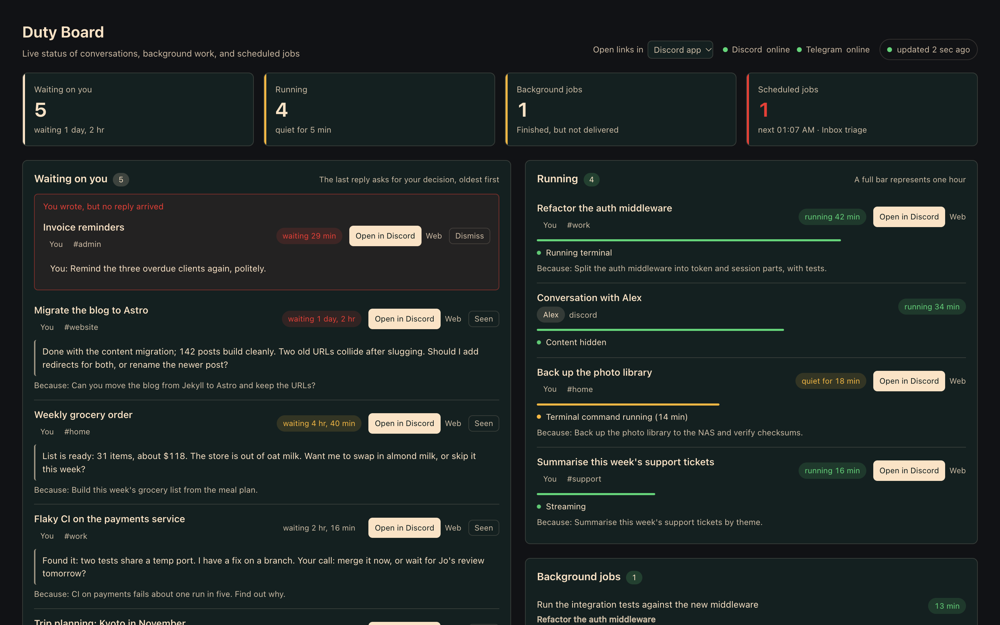
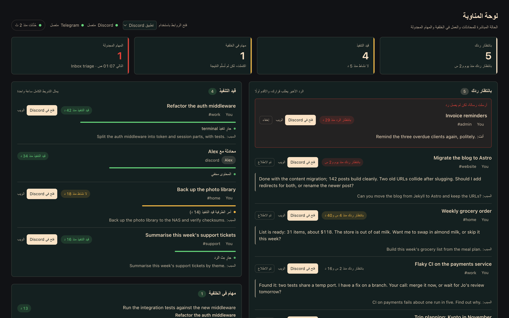

<div align="center">

# Hermes Duty Board

**See what's waiting on you across every Hermes conversation, in one live dashboard tab.**

English · [简体中文](README.zh-CN.md) · [日本語](README.ja.md)



</div>

If you run [Hermes Agent](https://github.com/NousResearch/hermes-agent) in Discord, Telegram or Feishu, the work spreads across dozens of threads. It gets easy to miss things:

- the agent asked you something two days ago and is still waiting;
- you sent a message and no reply ever came;
- a background job finished after the original thread had moved on;
- a cron job has been failing quietly since Tuesday.

Duty Board puts all of it on one page that refreshes every five seconds. Each conversation has a button that takes you straight back into it.

## What it shows

| Section | What you see |
|---|---|
| **Waiting on you** | Conversations whose last reply asks you a question or waits for your decision, oldest first, with what was asked and what started it. |
| **You wrote, but no reply arrived** | Conversations where you wrote last and no turn is running. These usually point to a dropped message. Shown at the top of *Waiting on you*. |
| **Running** | Turns in progress right now: elapsed time, what the agent is doing ("calling a model", "running terminal"), and a warning when a turn has gone quiet for 10 minutes. |
| **Background jobs** | Running `delegate_task` work. Also lists finished delegations whose result could not be delivered because the parent session was switched. |
| **Scheduled jobs** | Cron jobs that errored, failed delivery, are paused or overdue, plus a timeline of what runs next. |
| **Recently completed** | Replies from the last 24 hours that are reports rather than questions. Flags any reply that promised to come back later. |
| **Standing goals** | Active and paused `/goal`s with turn budget and the judge's last reason. |

**Jump straight in.** Cards in *Waiting on you* and *Running* have an **Open in Discord** button. It opens that thread in the Discord desktop app through `discord://`, scrolled to your message when the ID is known. A switch in the header lets you open links in the browser instead.

**Clear it when done.** *Seen* hides a card until that conversation gets a new message.

## Requirements

- Hermes Agent **0.21.1 or newer** with the web dashboard (`hermes dashboard`).
- Covers Discord, Telegram, Slack, WhatsApp, Signal, Matrix, Mattermost, Feishu, DingTalk, WeCom, Weixin, QQ, BlueBubbles, email and SMS sessions by default (`messaging_sources` changes the list). Jump buttons are Discord-only for now; other platforms show their conversations without one.

## Install

```bash
hermes plugins install xiaoyaner0201/hermes-duty-board
hermes plugins enable duty-board
```

Then restart the dashboard so it mounts the plugin's API routes:

```bash
hermes dashboard --stop && hermes dashboard
```

Open the dashboard. A **Duty Board** tab appears before *Sessions*.

## Chat summary

`/duty` replies with a compact, model-free summary in Discord and other Hermes chat platforms. `hermes duty` prints the same summary locally; `hermes duty --json` prints the raw board JSON for scripts.

- **Chat requires Hermes 0.21.7+** for trustworthy caller/session binding. On older gateways the command refuses; the CLI and local CLI/TUI `/duty` work on **0.21.1+**.
- **Chat is off under `plugins.isolation: host`.** The plugin host forwards a command's arguments but not who sent it, so `/duty` refuses there. The host also skips CLI registration, so `hermes duty` is not available either; the dashboard still works. Use `isolation: in_process` (the default) for chat and CLI summaries.
- **Owner only in chat.** Set `owner` to your platform user ID in `<HERMES_HOME>/duty-board/settings.json` (or `DUTY_BOARD_OWNER`, read from the routed profile's own `.env` in a multi-profile gateway). Other callers are refused before board data is read. The local CLI/TUI trusts the local account that can already read that home; it does not need a platform ID.
- **One-to-one DMs show details. Groups, channels, threads and group DMs show counts only**, without titles, excerpts or links. Details go only where the platform proves a one-to-one chat: Discord, Telegram, Feishu, Google Chat, Mattermost, and Slack IM channels whose id starts with `D` (Slack also calls group DMs "DMs"). Matrix (`m.direct` rooms can hold more people) and other platforms get counts. `/duty full` there adds a hint to DM the bot unless you explicitly set `"chat_full_in_channels": true`; even with that setting, the default stays counts-only. Enabling it can expose titles and locations from *other private conversations* to everyone in the destination channel.
- `/duty counts`, `/duty full lang=zh`, `hermes duty --counts` and `hermes duty --full --lang ja` are supported. Language priority is explicit argument, `chat_language` in settings, `HERMES_LANGUAGE`, Hermes `display.language` (block form in `config.yaml`), then English. All 17 locales work in chat and the CLI.

A channel reply from the fictional `dev/demo_home.py` home (actual command output):

```text
Duty Board · 5 waiting on you · 5 running · 1 cron problem
5 waiting on you
5 running
1 undelivered result
1 cron problem
```

## Configuration

Everything is optional. To change the defaults, create `~/.hermes/duty-board/settings.json` (or `<HERMES_HOME>/duty-board/settings.json`):

```json
{
  "owner": "123456789012345678",
  "hide_other_people_content": true,
  "people": { "123456789012345678": "Me", "234567890123456789": "Alex" },
  "window_days": 7,
  "stall_seconds": 600
}
```

| Key | Default | Meaning |
|---|---|---|
| `owner` | unset | Platform user ID whose conversations count as yours. If unset, every conversation counts on the dashboard/local CLI, but chat commands refuse. Also settable via `DUTY_BOARD_OWNER`. |
| `hide_other_people_content` | `true` | When `owner` is set, other people's conversations are left out of *Waiting on you* and *Recently completed*. Their running turns and background jobs show only as "Conversation with …", with no content and no link. |
| `chat_language` | Hermes language, then `en` | Default chat/CLI summary language; `lang=` / `--lang` overrides it. |
| `chat_full_in_channels` | `false` | Only literal `true` permits explicit `/duty full` outside DMs. |
| `people` | `{}` | Display labels for user IDs. Without one, the platform user name is shown. |
| `window_days` | `7` | How far back to look for conversations. |
| `stall_seconds` | `600` | How long a running turn can be silent before it is flagged. |
| `unanswered_grace_seconds` | `180` | How long your last message can go unanswered before it is listed as *You wrote, but no reply arrived*. |
| `recent_done_hours` | `24` | Window for *Recently completed*. |
| `goal_lookback_days` | `14` | Older goals are counted, not listed. |
| `messaging_sources` | see above | Hermes session sources to include, e.g. `["discord", "telegram"]`. |

**Shared threads.** Hermes shares one session per thread by default, so several people can talk in it. When Hermes recorded who sent the latest message, the board attributes the conversation to that person. Otherwise it attributes it to whoever started the thread. Either way, everything shown from a shared thread is already visible to everyone in that thread. Direct messages and per-user group sessions are never mixed.

## How "waiting on you" is decided

The plugin calls no model. It reads only the last one or two meaningful lines of the final reply, skipping attachments, links and footnotes. It looks for a question mark (`?`, `？`, `؟`) or a hand-off phrase ("should I…", "let me know", "your call"; "要不要我…", "你定"; "よろしいですか", "教えてください"). Questions in the middle of a long report do not count.

This is a heuristic. You will see the odd false positive; *Seen* clears it. The question-mark rule covers every language; hand-off phrases without a question mark are matched for English, Chinese and Japanese, and contributions for other languages are welcome.

## Privacy and safety

- **Read-only.** Opens `state.db` with SQLite `mode=ro` and reads `cron/jobs.json` and `gateway_state.json`.
- **One file written, by dashboard dismissals only.** Chat/CLI commands never write or dismiss. The dashboard writes only its own dismiss list at `<HERMES_HOME>/duty-board/dismissed.json`.
- **No network, no model calls, no credentials.** It never reads `.env`, `auth.json` or any token store.
- **Chat privacy.** Only the configured owner can request a summary in messaging platforms. DMs show titles, places and ages, plus web links on Discord; shared destinations show counts by default. Explicit channel opt-in can reveal private-conversation metadata to other participants. Other people’s hidden conversations stay hidden; mentions and Markdown are neutralized.
- **Behind the dashboard's auth gate.** The API is mounted under `/api/plugins/duty-board/` like any other dashboard plugin.
- **Stable for one Hermes version, not across all of them.** The plugin reads Hermes's internal tables. If a future Hermes release changes one, the affected section shows an empty list and a warning banner instead of breaking the page. Please open an issue when that happens.

## Languages

The tab speaks every language the Hermes dashboard ships, 17 in all: English, 简体中文, 繁體中文, 日本語, 한국어, Deutsch, Español, Français, Italiano, Português, Русский, Українська, Türkçe, Magyar, Afrikaans, Gaeilge and العربية (right-to-left). It follows the dashboard's language switch live. Counts use each language's plural rules, and durations, numbers and lists are formatted by the browser's `Intl` APIs.

Translations live in `dashboard/i18n/<locale>.json`, with `en.json` as the source of truth. Corrections from native speakers are very welcome; see [CONTRIBUTING.md](CONTRIBUTING.md#translations).

<details>
<summary>Right-to-left: the same board in Arabic</summary>



</details>

## Development

```bash
python -m venv .venv && . .venv/bin/activate
pip install -r requirements-dev.txt
python -m pytest
node --check dashboard/dist/index.js && node tools/build_i18n.mjs --check && node tests/js/i18n_check.mjs
```

`dev/harness/` renders the tab outside Hermes against a synthetic Hermes home, which is how the screenshot above was made. See [dev/README.md](dev/README.md).

## Contributing

Issues and pull requests are welcome; see [CONTRIBUTING.md](CONTRIBUTING.md). Report security problems privately as described in [SECURITY.md](SECURITY.md).

## License

[Apache-2.0](LICENSE)
