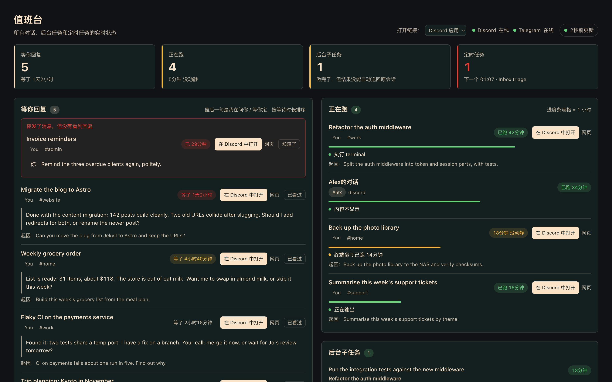

<div align="center">

# Hermes 值班台

**一个实时看板，把所有 Hermes 对话里等你处理的事集中到一页。**

[English](README.md) · 简体中文 · [日本語](README.ja.md)



</div>

在 Discord、Telegram 或飞书里用 [Hermes Agent](https://github.com/NousResearch/hermes-agent)，对话很快就会散到几十个子区，下面这些事很容易被漏掉：

- agent 两天前问了你一句，到现在还在等你回；
- 你发了消息，却一直没收到回复；
- 后台任务跑完时，原来的会话已经切走，结果没送回去；
- 某个定时任务从周二开始一直在悄悄报错。

值班台把这些都放到一页上，每 5 秒刷新一次；每个对话旁边都有按钮，一点就能回到那个对话。

## 页面上有什么

| 区块 | 内容 |
|---|---|
| **等你回复** | 最后一句是在问你、等你拍板的对话。等得最久的排最前，并显示问了什么、起因是你哪句话。 |
| **你发了消息，但没有看到回复** | 你发了最后一条、此刻又没有任务在跑的对话，通常意味着消息被漏掉了。显示在「等你回复」最上方。 |
| **正在跑** | 此刻进行中的任务：已经跑了多久、agent 在做什么（等模型响应、执行终端命令……）；超过 10 分钟没动静会变黄。 |
| **后台子任务** | 正在运行的 `delegate_task`。如果子任务做完时原会话已被切换、结果没能送回，也会单独列出来。 |
| **定时任务** | 报错、投递失败、已暂停或到点没跑的任务，以及接下来要跑的时间线。 |
| **最近完成** | 24 小时内交差的回复（是汇报，不是提问）。说过“之后会回来汇报”的会加标记。 |
| **长期目标** | 进行中或暂停的 `/goal`，带轮数和判定器最近给出的理由。 |

**一键跳转**：「等你回复」和「正在跑」的卡片上都有 **在 Discord 中打开** 按钮。点它会通过 `discord://` 在 Discord 桌面客户端里打开对应子区；能拿到消息 ID 时，会直接定位到你那条消息。也可以在页头切换成用浏览器打开。

**处理完就收起**：点「已看过」收起卡片，那个对话有了新消息会自动重新出现。

## 运行要求

- Hermes Agent **0.21.1 及以上**，并启用网页后台（`hermes dashboard`）。
- 默认覆盖 Discord、Telegram、Slack、WhatsApp、Signal、Matrix、Mattermost、飞书、钉钉、企业微信、微信、QQ、BlueBubbles、邮件和短信的会话，可用 `messaging_sources` 调整。跳转按钮目前只支持 Discord；其他平台的对话照样会显示，只是没有跳转按钮。

## 安装

```bash
hermes plugins install xiaoyaner0201/hermes-duty-board
hermes plugins enable duty-board
```

插件的接口只在后台启动时挂载，所以装完要重启一次后台：

```bash
hermes dashboard --stop && hermes dashboard
```

打开后台，在「会话」前面会多出一个 **Duty Board** 标签。

## 聊天摘要

`/duty` 在 Discord 等 Hermes 聊天平台回复一份简短摘要，不调用模型。`hermes duty` 在本地终端显示同样的摘要；`hermes duty --json` 输出原始看板 JSON，方便脚本使用。

- **聊天需要 Hermes 0.21.7+**，才能可靠识别调用者和会话。旧版网关会拒绝命令；终端命令及本地 CLI/TUI 的 `/duty` 在 **0.21.1+** 即可使用。
- **`plugins.isolation: host` 下不提供聊天摘要**。插件宿主进程只转发命令参数，不转发是谁发的，所以 `/duty` 会拒绝。宿主进程也不注册命令行命令，`hermes duty` 同样不可用；仪表盘照常可用。需要聊天和命令行摘要请使用默认的 `isolation: in_process`。
- **聊天只允许看板主人调用**。在 `<HERMES_HOME>/duty-board/settings.json` 中将 `owner` 设为你的平台用户 ID（也可用 `DUTY_BOARD_OWNER`；多 profile 网关中读取被路由 profile 自己的 `.env`）。其他人调用时，不读取看板就直接拒绝。本地 CLI/TUI 信任有权读取该目录的本机账号，不需要平台 ID。
- **一对一私聊显示详情；群聊、频道、子区和多人私信默认只显示数量**，不含标题、引用和链接。只在平台能证明是一对一的地方显示详情：Discord、Telegram、飞书、Google Chat、Mattermost，以及 ID 以 `D` 开头的 Slack 私聊（Slack 把多人私信也标成私聊）。Matrix（`m.direct` 房间可能不止两人）和其他平台只显示数量。此时 `/duty full` 会提示私聊机器人，除非明确设置 `"chat_full_in_channels": true`。即使开启，默认仍只显示数量。开启后，目的频道里的所有人都可能看到来自其他私密会话的标题和位置。
- 可用 `/duty counts`、`/duty full lang=zh`、`hermes duty --counts` 和 `hermes duty --full --lang ja`。语言依次取显式参数、设置里的 `chat_language`、`HERMES_LANGUAGE`、Hermes 的 `display.language`（`config.yaml` 中的块格式）、英文；聊天和终端均支持 17 种语言。

虚构演示目录 `dev/demo_home.py` 的频道回复（来自真实命令运行）：

```text
值班台 · 5 项等你回复 · 5 项进行中 · 1 项定时任务异常
5 项等你回复
5 项进行中
1 项结果未送达
1 项定时任务异常
```

## 配置

所有配置都可选。要改默认值，就新建 `~/.hermes/duty-board/settings.json`（即 `<HERMES_HOME>/duty-board/settings.json`）：

```json
{
  "owner": "123456789012345678",
  "hide_other_people_content": true,
  "people": { "123456789012345678": "我", "234567890123456789": "小明" },
  "window_days": 7,
  "stall_seconds": 600
}
```

| 键 | 默认值 | 作用 |
|---|---|---|
| `owner` | 不设置 | 看板主人在平台上的用户 ID，只有这个人的对话才算“你的”。不设置时，后台和本地终端将所有对话视为你的且不隐藏，但聊天命令会拒绝。也可以用环境变量 `DUTY_BOARD_OWNER` 设置。 |
| `hide_other_people_content` | `true` | 设置了 `owner` 时，其他人的对话不进「等你回复」和「最近完成」；他们正在跑的任务和后台子任务只显示“与某某的对话”，没有内容，也没有跳转链接。 |
| `chat_language` | Hermes 语言，其次 `en` | 聊天/终端摘要的默认语言，可用 `lang=` / `--lang` 覆盖。 |
| `chat_full_in_channels` | `false` | 只有布尔值 `true` 才允许在非私聊中显式使用 `/duty full`。 |
| `people` | `{}` | 给用户 ID 起显示名；不设置就显示平台上的用户名。 |
| `window_days` | `7` | 往回看多少天的对话。 |
| `stall_seconds` | `600` | 正在跑的任务多久没动静就标黄。 |
| `unanswered_grace_seconds` | `180` | 你的最后一条消息多久没人回，就列进「你发了消息，但没有看到回复」。 |
| `recent_done_hours` | `24` | 「最近完成」的时间范围。 |
| `goal_lookback_days` | `14` | 超过这个天数的旧目标只计数，不展开列出。 |
| `messaging_sources` | 见上文 | 要纳入的 Hermes 会话来源，例如 `["discord", "telegram"]`。 |

**共享子区**：Hermes 默认一个子区共用一个会话，所以可能有好几个人在里面说话。如果 Hermes 记下了最新那条消息是谁发的，看板就把这个对话算给那个人；否则算给开这个子区的人。不管算给谁，看板从共享子区里显示的内容，子区里的每个人本来就都能看到。私聊和按人分开的群组会话不会混在一起。

## 怎么判断“在等你”

插件不调用任何模型。它只看最后一条回复里最后一两行有意义的内容（附件、链接、脚注会跳过），找问号（`?`、`？`、`؟`）或交给你决定的说法，例如“要不要我……”“你定”，以及英文、日文里的同类表达。长篇汇报中间出现的问句不算。

这是一种经验规则，偶尔会误判，点「已看过」收起即可。问号规则对所有语言都有效；不带问号的“交给你决定”说法目前只识别中文、英文、日文，欢迎补充其他语言的规则。

## 隐私与安全

- **只读**：用 SQLite `mode=ro` 打开 `state.db`，另外只读 `cron/jobs.json` 和 `gateway_state.json`。
- **只有后台收起操作写一个文件**：聊天/终端命令从不写入，也不收起。后台只写自己的收起列表 `<HERMES_HOME>/duty-board/dismissed.json`。
- **不联网、不调用模型、不碰凭据**：不读 `.env`、`auth.json` 或任何存储 token 的地方。
- **聊天隐私**：聊天平台只允许配置的主人请求摘要。私聊显示标题、位置和时长，Discord 上另附网页链接；共享目的地默认只显示数量。显式开启频道全文后，其他参与者可能看到私密会话的元数据。其他人被隐藏的对话仍不显示内容；提及与 Markdown 都经过处理。
- **受后台登录保护**：接口挂在 `/api/plugins/duty-board/` 下，和其他后台插件一样需要先登录后台。
- **依赖 Hermes 内部数据表**：插件读的是 Hermes 内部表，它们不是对外承诺稳定的接口。将来哪次升级改了表结构，受影响的区块会显示为空并给出提示，整页不会挂掉。遇到这种情况请提 issue。

## 多语言

Hermes 后台自带的 17 种语言，值班台全部支持：English、简体中文、繁體中文、日本語、한국어、Deutsch、Español、Français、Italiano、Português、Русский、Українська、Türkçe、Magyar、Afrikaans、Gaeilge、العربية（从右往左排版）。在后台切换语言，值班台会立刻跟着变。数量按各语言自己的单复数规则显示，时长、数字和列表交给浏览器的 `Intl` 接口格式化。

译文放在 `dashboard/i18n/<语言>.json`，以 `en.json` 为准。欢迎母语使用者帮忙纠正，做法见 [CONTRIBUTING.md](CONTRIBUTING.md#translations)。

## 开发

```bash
python -m venv .venv && . .venv/bin/activate
pip install -r requirements-dev.txt
python -m pytest
node --check dashboard/dist/index.js && node tools/build_i18n.mjs --check && node tests/js/i18n_check.mjs
```

`dev/harness/` 可以脱离 Hermes，用一份模拟的 Hermes 数据目录渲染这个页面，上面的截图就是这样做的。详见 [dev/README.md](dev/README.md)。

## 参与贡献

欢迎提 issue 和 PR，流程见 [CONTRIBUTING.md](CONTRIBUTING.md)；安全问题请按 [SECURITY.md](SECURITY.md) 私下报告。

## 许可证

[Apache-2.0](LICENSE)
