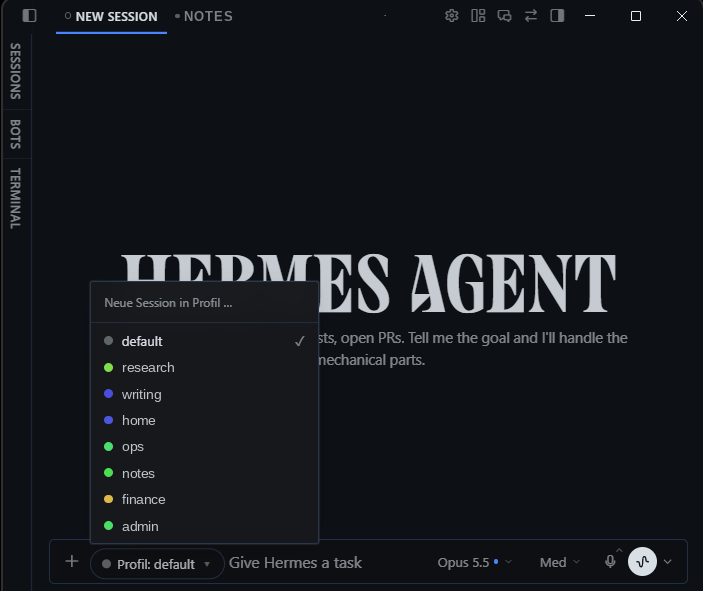
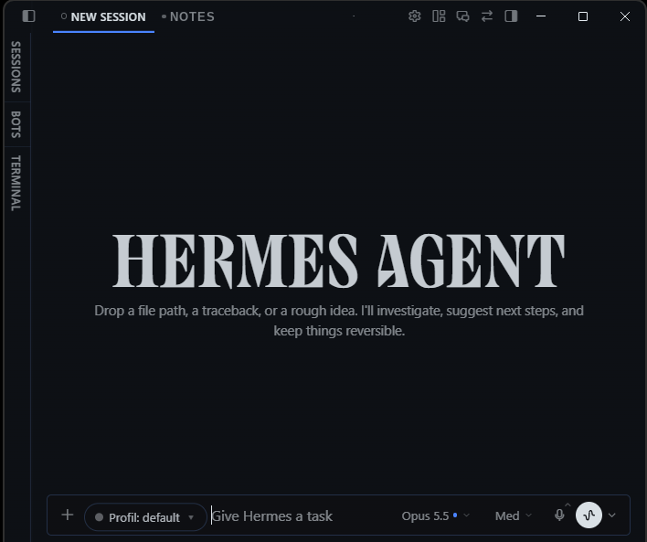
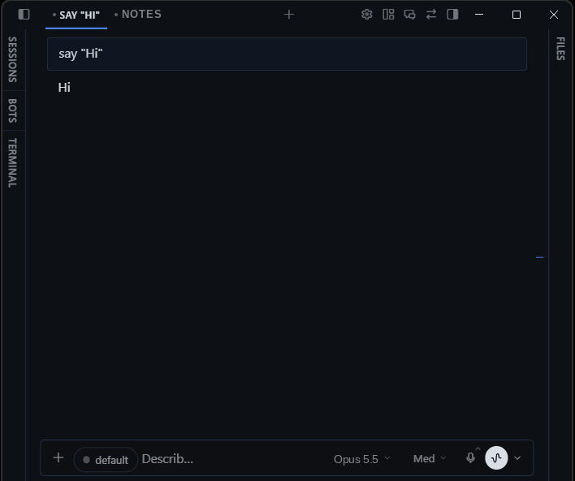

# Profile Picker for Hermes Desktop

Choose **which profile a new chat runs in** right where you start it — in the composer, next to the model pill — instead of hunting for the small profile squares at the foot of the sidebar.

## Screenshots

New chat, picker open:



New chat, picker closed:



Running chat with the read-only profile chip:



Profile names, tab titles and the model label in these screenshots were anonymised; the status bar was cropped.

## What it does

- **New, unsent chat:** a `Profile: <name> ▾` dropdown sits at the start of the composer. Pick a profile and a fresh draft opens in that profile. Text you already typed is carried over.
- **Running chat:** the same spot shows a read-only chip with the chat's profile, so you always see which agent you are talking to. (A running session cannot be moved to another profile, so the chip is not a picker.)
- **Command palette (Ctrl/Cmd+K):** one entry per profile, `New chat in profile: <name>`.
- With only one profile, nothing is shown.
- English and German UI; other app languages fall back to English.

Works with local and remote backends: the new chat is routed through the profile's route on the current gateway connection.

## Install

Requires Hermes Agent **0.21.5 or newer** with the Desktop app.

```bash
hermes plugins install https://github.com/weltmaister/hermes-profile-picker
```

Then enable **Profile Picker** under **Capabilities → Plugins** in the Desktop app.

Manual install: copy `desktop/plugin.js` to `<HERMES_HOME>/desktop-plugins/profile-picker/plugin.js` on the machine that runs the Desktop app (`%LOCALAPPDATA%\hermes` on Windows, `~/.hermes` elsewhere) and run **Reload desktop plugins** from the command palette.

## How it works

Desktop-only; the Python half is an empty stub. The UI uses only public Desktop plugin SDK surfaces:

- `COMPOSER_AREAS.leading` slot for the picker / chip
- `host.profiles.list()` for the profile list
- `host.profileRoutes()` + `host.newChat(route)` to open the draft in the chosen profile
- `host.composer.getDraft/setDraft('new', …)` to carry typed text over
- `host.state.focusedStoredSessionId` / `focusedSessionProfile` for the chip
- `PALETTE_AREA` for the palette entries, `ctx.i18n` for the strings

If the running Desktop build lacks one of these, the plugin registers nothing and shows a one-time notice.

## Privacy and behaviour

No network calls, no telemetry, no file access, no stored data, no background processes, no credentials. It does not patch or query the app's internal markup.

## Limitations

- Carrying over typed text relies on `host.composer`; on Desktop builds without it the new draft starts empty.
- Existing sessions cannot be re-assigned to another profile; that is a Hermes limitation, not something a plugin can change.

## License

MIT
